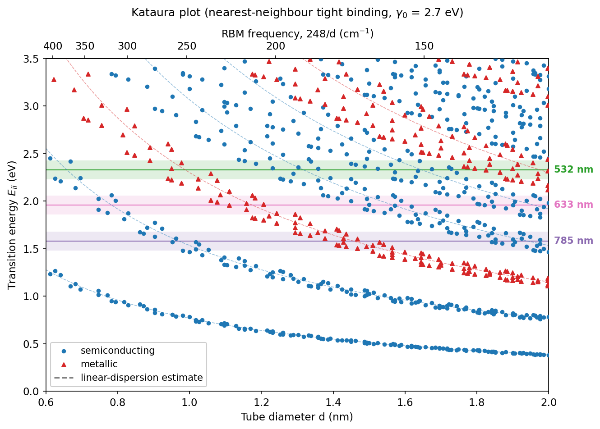
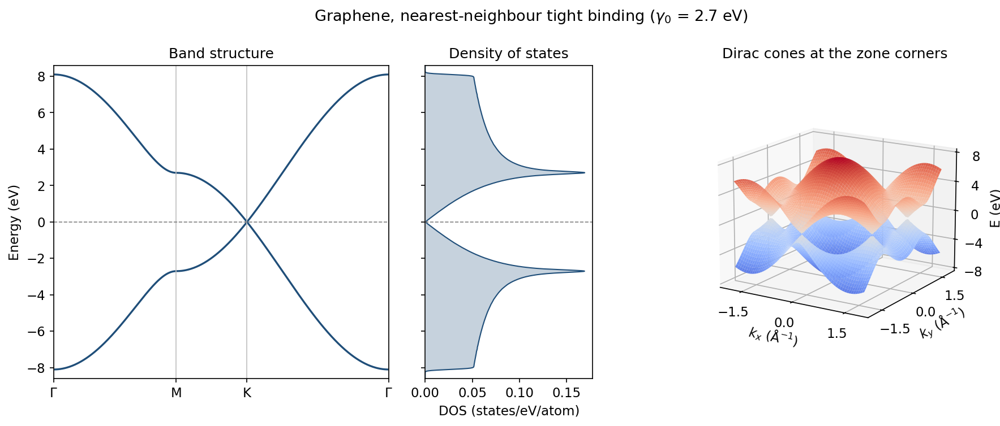
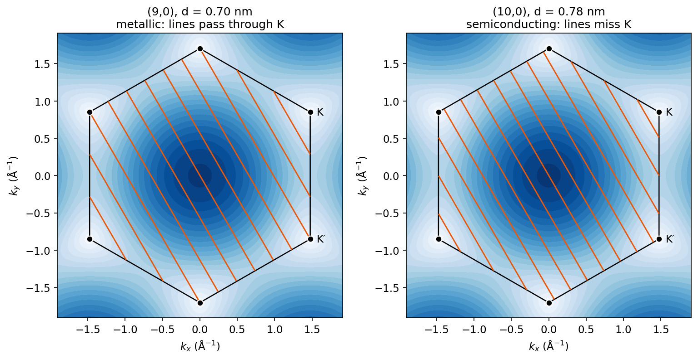
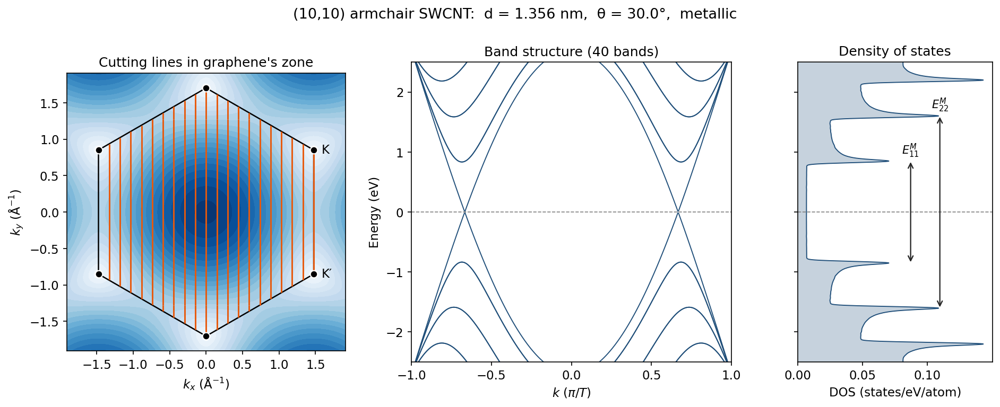
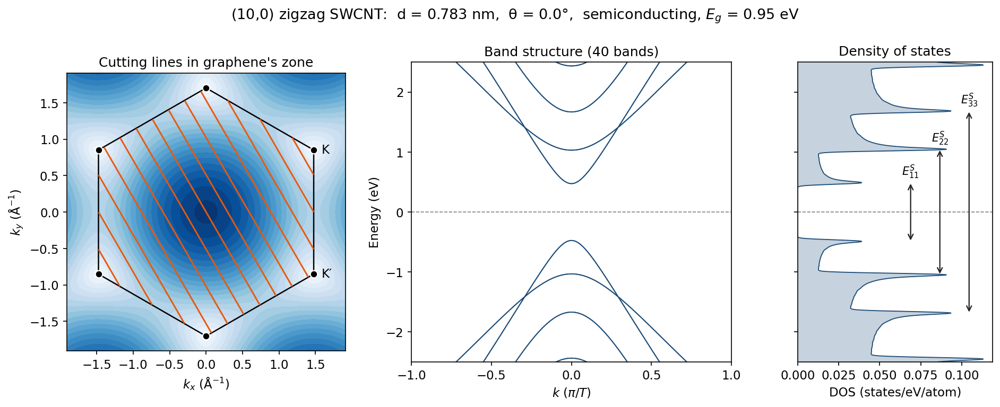

# Tight-Binding Band Structure of Graphene and Carbon Nanotubes

A Python implementation of the nearest-neighbour tight-binding model for graphene and the zone-folding method for single-walled carbon nanotubes (SWCNTs). For any chirality (n, m) it calculates the band structure, density of states, band gap, and optical transition energies $E_{ii}$. It also builds a Kataura plot and predicts which nanotubes a given Raman laser will excite, which connects the calculation directly to resonance Raman measurements.



## Features

- Graphene π bands from the 2 × 2 tight-binding Hamiltonian, checked against direct diagonalization
- Zone folding for any (n, m): geometry, cutting lines, 1D bands, and density of states
- Metallic or semiconducting classification, band gaps, and van Hove singularity transitions $E_{ii}$
- Kataura plot with laser resonance windows and a radial breathing mode (RBM) frequency axis
- Command-line tool that lists the (n, m) species resonant with a laser, optionally filtered by a measured RBM peak
- 43 unit tests against analytic results for graphene, zigzag tubes, and armchair tubes

## Physics

### Graphene

Each carbon atom contributes one $2p_z$ orbital, and the honeycomb lattice has two atoms per unit cell. With nearest-neighbour hopping $\gamma_0$, the Bloch Hamiltonian is

$$
H(\mathbf{k}) = \begin{pmatrix} 0 & -\gamma_0 f(\mathbf{k}) \\ -\gamma_0 f^*(\mathbf{k}) & 0 \end{pmatrix},
\qquad f(\mathbf{k}) = 1 + e^{i\mathbf{k}\cdot\mathbf{a}_1} + e^{i\mathbf{k}\cdot\mathbf{a}_2},
$$

so $E_\pm(\mathbf{k}) = \pm\gamma_0 |f(\mathbf{k})|$. The two bands touch at the corners K and K′ of the Brillouin zone, where $f = 0$, forming the Dirac cones. An optional overlap parameter $s$ breaks the electron–hole symmetry.

### Zone folding

An (n, m) nanotube is a graphene sheet rolled up along the chiral vector $\mathbf{C}_h = n\mathbf{a}_1 + m\mathbf{a}_2$. The wavefunction must be single-valued around the circumference, so $\mathbf{k}\cdot\mathbf{C}_h = 2\pi\mu$ and only states on $N$ parallel cutting lines survive:

$$
\mathbf{k} = \mu\,\mathbf{K}_1 + k\,\frac{\mathbf{K}_2}{|\mathbf{K}_2|}, \qquad \mu = 0, \dots, N-1, \qquad -\frac{\pi}{T} \le k < \frac{\pi}{T}.
$$

Here $N = 2(n^2 + m^2 + nm)/d_R$ is the number of hexagons in the unit cell, $d_R = \gcd(2n+m,\ 2m+n)$, and $T$ is the unit cell length along the axis. Each nanotube band is graphene's band evaluated along one cutting line.

### Metallic or semiconducting

If a cutting line passes through a K point, the tube inherits graphene's band crossing and is metallic. This happens exactly when $n - m$ is divisible by 3, so about one third of all chiralities are metallic. Otherwise the nearest line misses K by one third of the line spacing $|\mathbf{K}_1| = 2/d$, which gives a band gap $E_g \approx 2 a_{\mathrm{CC}}\gamma_0 / d$.

### Van Hove singularities and the Kataura plot

Where a cutting line passes closest to K, its band is flat ($dE/dk = 0$), which produces a sharp van Hove singularity in the 1D density of states. Optical absorption and resonance Raman scattering are strongest when the photon energy matches a transition $E_{ii}$ between mirror-image singularities in the valence and conduction bands. Plotting $E_{ii}$ against diameter for every chirality gives the Kataura plot. A tube shows up in a Raman spectrum only when one of its $E_{ii}$ lies within roughly 0.1 eV of the laser energy, which is why different lasers see different tubes in the same sample.

## Results

### Graphene



The bands cross linearly at K, the density of states vanishes linearly at the Fermi level, and the saddle points at M produce logarithmic van Hove singularities at $\pm\gamma_0$.

### Why (n − m) mod 3 matters



The (9,0) and (10,0) tubes have similar diameters, but only the (9,0) cutting lines pass through the Dirac points (black dots), so (9,0) is metallic and (10,0) is semiconducting.

### Nanotube bands and density of states





The armchair (10,10) tube has two bands crossing the Fermi level at $k = \pm 2\pi/3T$ and a constant density of states between its first pair of singularities. The zigzag (10,0) tube has a 0.95 eV gap. The arrows mark the optical transitions $E_{ii}$. A chiral example, (6,5), is in [`figures/tube_6_5.png`](figures/tube_6_5.png).

### Kataura plot

The Kataura plot at the top shows every tube between 0.6 and 2.0 nm. The dashed curves are the linear-dispersion estimates $E_{ii} \approx p\,a_{\mathrm{CC}}\gamma_0/d$ with $p = 2, 4, 8, 10$ for semiconducting and $p = 6, 12$ for metallic tubes. The points spread around these curves because graphene's bands are not perfectly conical away from K (trigonal warping). The same effect splits each metallic $E_{ii}^M$ into two branches for every tube except armchair. The shaded bands are ±0.1 eV resonance windows for common Raman lasers, and the top axis converts diameter to RBM frequency.

## Usage

Requires Python 3.9+.

```bash
pip install -r requirements.txt

python -m cnt_tb tube 10 0                 # summary and figure for one tube
python -m cnt_tb laser 532                 # tubes resonant with a 532 nm laser
python -m cnt_tb laser 532 --rbm 250       # ...that also match an RBM peak at 250 cm^-1
python -m cnt_tb figures                   # regenerate every figure in this README
```

Every command accepts `--gamma0` (hopping energy, default 2.7 eV) and `--overlap` (default 0). Run `python -m cnt_tb laser --help` for the resonance window, diameter range, and RBM options.

Example output of `python -m cnt_tb tube 10 0`:

```text
(10,0) zigzag SWCNT
  diameter            0.783 nm
  chiral angle        0.00 deg
  electronic type     semiconducting  ((n - m) mod 3 = 1)
  hexagons / cell     20
  atoms / cell        40
  cell length |T|     4.260 angstrom
  band gap            0.948 eV
  RBM (248/d)         316.8 cm^-1
  optical transitions (gamma0 = 2.70 eV):
    E11S     0.948 eV   ( 1308 nm)
    E22S     2.063 eV   (  601 nm)
    E33S     3.337 eV   (  372 nm)
```

Example output of `python -m cnt_tb laser 532 --dmin 0.8 --dmax 1.3`:

```text
Laser 532 nm = 2.331 eV, resonance window +/- 0.10 eV
Diameters 0.80-1.30 nm

(n,m)    type   d (nm)  RBM (cm^-1)     E_ii   E (eV)  detuning
(8,5)    M       0.889        278.9    E11M-    2.427    +0.097
(12,0)   M       0.939        264.0    E11M-    2.237    -0.094
(7,7)    M       0.949        261.3     E11M    2.343    +0.012
(10,4)   M       0.978        253.6    E11M+    2.403    +0.072
(9,6)    M       1.024        242.2    E11M+    2.234    -0.096
(13,1)   M       1.059        234.2    E11M+    2.293    -0.038
(13,3)   S       1.153        215.0     E33S    2.424    +0.093
(12,5)   S       1.185        209.3     E33S    2.394    +0.063
(11,7)   S       1.230        201.6     E33S    2.349    +0.018
(16,0)   S       1.253        198.0     E33S    2.237    -0.094
(15,2)   S       1.260        196.8     E33S    2.231    -0.100
(10,9)   S       1.289        192.4     E33S    2.290    -0.041
```

### Python API

```python
from cnt_tb import Nanotube

tube = Nanotube(6, 5)
print(tube.diameter, tube.chiral_angle, tube.is_metallic)   # ~0.747 (nm), ~27.0 (deg), False
print(tube.band_gap())                                       # ~1.016 (eV)

for t in tube.transition_energies(emax=3):
    print(t.label, round(t.energy, 3))                       # E11S 1.016, then E22S 2.024

k, ev, ec = tube.bands()                # valence and conduction bands, one per cutting line
E, dos = tube.density_of_states()       # states / eV / atom
```

## Tests

```bash
pytest
```

The tests check that:

- the closed-form graphene bands match direct diagonalization of $H(\mathbf{k})$ and $S(\mathbf{k})$, with and without overlap
- the band energies at Γ, M, and K are $3\gamma_0$, $\gamma_0$, and 0
- the geometry satisfies $\mathbf{C}_h\cdot\mathbf{K}_1 = \mathbf{T}\cdot\mathbf{K}_2 = 2\pi$ and $\mathbf{C}_h\cdot\mathbf{K}_2 = \mathbf{T}\cdot\mathbf{K}_1 = 0$, and known diameters, chiral angles, and atom counts are reproduced
- the numerical band gap obeys the (n − m) mod 3 rule for all 90 tubes with n ≤ 12
- zigzag gaps equal $2\gamma_0 \min_\mu |1 + 2\cos(\mu\pi/n)|$ and armchair $E_{11}^M = 2\gamma_0\sin(\pi/n)$
- large semiconducting tubes approach $E_g = 2a_{\mathrm{CC}}\gamma_0/d$
- every DOS integrates to one state per atom, and the (10,10) DOS at the Fermi level matches $\sqrt{3}\,a_{\mathrm{CC}}/(\pi^2\gamma_0 d)$

## Project structure

```text
cnt_tb/
  graphene.py    lattice vectors, tight-binding bands, graphene DOS
  nanotube.py    Nanotube class: geometry, zone folding, band gap, E_ii, DOS
  kataura.py     Kataura plot data and laser-resonance search
  raman.py       laser energy and RBM-diameter conversions
  dos.py         Gaussian-broadened density of states
  plotting.py    all figures
  __main__.py    command-line interface
tests/
  test_physics.py
figures/         generated by `python -m cnt_tb figures`
```

## Limitations

This is the simplest model that captures nanotube electronic structure, and it has known limits.

- **Flat-sheet, nearest-neighbour physics only.** Curvature opens small gaps (a few to tens of meV, scaling as $1/d^2$) in metallic tubes that are not armchair, and σ–π hybridization changes the bands of tubes thinner than about 0.7 nm.
- **No excitonic or many-body effects.** Measured $E_{ii}$ values differ from these single-particle values by up to a few tenths of an eV. For (6,5), the model gives $E_{11} = 1.02$ eV and $E_{22} = 2.02$ eV, while fluorescence measurements give about 1.27 eV and 2.2 eV. Use the resonance predictions as a guide and confirm (n, m) assignments against an experimental Kataura plot.
- **Empirical parameters.** $\gamma_0$ is fitted to experiment, and values from about 2.5 to 3.0 eV appear in the literature. The RBM relation ω = 248/d applies to isolated tubes on Si/SiO₂; bundles and surfactant-wrapped tubes need different constants (set them with `--rbm-A` and `--rbm-B`).

## References

1. R. Saito, G. Dresselhaus, and M. S. Dresselhaus, *Physical Properties of Carbon Nanotubes* (Imperial College Press, 1998).
2. A. H. Castro Neto et al., "The electronic properties of graphene," *Rev. Mod. Phys.* **81**, 109 (2009).
3. H. Kataura et al., "Optical properties of single-wall carbon nanotubes," *Synth. Met.* **103**, 2555 (1999).
4. A. Jorio et al., "Structural (n, m) determination of isolated single-wall carbon nanotubes by resonant Raman scattering," *Phys. Rev. Lett.* **86**, 1118 (2001).
5. S. M. Bachilo et al., "Structure-assigned optical spectra of single-walled carbon nanotubes," *Science* **298**, 2361 (2002).
